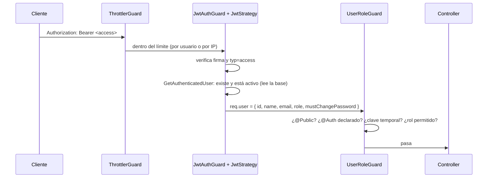
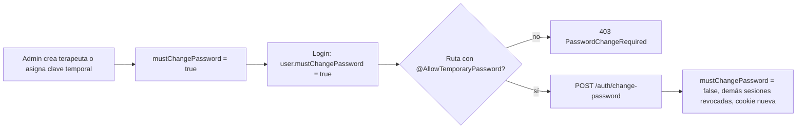

# Módulo `auth`

Inicio de sesión de la plataforma web, sesiones con JWT + refresh rotado, recuperación y cambio de contraseña, clave temporal y **protección global de todas las rutas** (rate limit → JWT → rol). Los demás módulos no implementan seguridad propia: usan los decoradores que exporta este.

| Dato         | Valor                                                                                                                  |
| ------------ | ---------------------------------------------------------------------------------------------------------------------- |
| Specs        | [101 — Inicio de sesión web y roles](../../../caa-spec-driven-development-SDD-/specs/101-login-web-y-roles/spec.md) (FR-001 a FR-006) |
| Constitución | §3 rutas públicas, §5 roles `THERAPIST` / `ADMIN`                                                                      |
| Depende de   | `PrismaModule` (global), `ConfigModule`, `common/` (errores)                                                           |
| Lo usan      | todos los módulos (decoradores) y `users` (repositorio, hasher, auditoría)                                             |
| Pruebas      | [`test/auth.e2e-spec.ts`](../../test/auth.e2e-spec.ts)                                                                 |

## Reglas de negocio

| Regla                                                                                                                              | Origen                         | Dónde se cumple                                                                                  |
| ---------------------------------------------------------------------------------------------------------------------------------- | ------------------------------ | ------------------------------------------------------------------------------------------------ |
| Contraseña de 10+ caracteres con letras y números, guardada con argon2id                                                           | 101 FR-001                     | `assertPasswordPolicy` en `domain/entities/user.entity.ts`, `security/argon2-password.hasher.ts` |
| Mismo error para correo inexistente, clave errónea o usuario desactivado                                                           | 101 criterios                  | `application/login.use-case.ts` → `InvalidCredentials`                                           |
| 5 fallos en 15 min bloquean el correo 15 min, exista o no                                                                          | 101 criterios                  | `domain/entities/login-attempt.entity.ts`                                                        |
| Access token JWT de 15 min; refresh opaco de 7 días, rotado en cada uso                                                            | 101 FR-002                     | `security/jwt-token.service.ts`, `domain/entities/refresh-token.entity.ts`                       |
| Reusar un refresh ya rotado cierra **todas** las sesiones (robo)                                                                   | 101 FR-002                     | `application/refresh-session.use-case.ts`                                                        |
| Refresh en cookie `httpOnly`, `Secure`, `SameSite=Strict`, solo a `/auth`                                                          | 101 FR-003                     | `http/auth.controller.ts`                                                                        |
| Enlace de recuperación de 30 min y un solo uso; responde igual exista o no el correo                                               | 101 criterios                  | `forgot-password` / `reset-password` use cases                                                   |
| Clave temporal: el login avisa `mustChangePassword` y la API responde `403 PasswordChangeRequired` en todo salvo `change-password` | 101 FR-006, acuerdo 2026-10-21 | `http/guards/user-role.guard.ts` + `@AllowTemporaryPassword()`                                   |
| Cambiar o recuperar la contraseña quita la clave temporal y cierra las demás sesiones                                              | 101 FR-006                     | `User.changePassword()`, `AuthRepository.savePasswordChange()`                                   |
| Toda ruta exige token salvo `@Public()`; una ruta sin `@Auth` ni `@Public` se rechaza                                              | Constitución §3                | `jwt-auth.guard.ts`, `user-role.guard.ts`                                                        |
| El rol y el estado se leen de la base en cada petición (desactivar aplica al instante)                                             | 101 FR-004                     | `http/jwt.strategy.ts` → `GetAuthenticatedUserUseCase`                                           |
| Login, logout, recuperación y cambios de clave se auditan                                                                          | 101 FR-005, spec 109           | `prisma/auth-audit.prisma.ts`                                                                    |
| No hay autorregistro ni endpoint que cree administradores                                                                          | Acuerdo 2026-10-21             | el admin inicial sale de `prisma/seed.ts`                                                        |
| La terapeuta crea su PIN de tableta (4–6 dígitos, sin secuencias) confirmando su contraseña; se guarda solo el hash argon2id       | 002                            | `set-pin.use-case.ts`, `assertPinPolicy`                                                         |

## Estructura

```
auth/
├── auth.module.ts              cableado: puerto → adaptador; exporta lo que usa users
├── index.ts                    API pública del módulo (lo único que importan los demás)
├── domain/                     núcleo puro: sin Nest ni Prisma
│   ├── entities/               User (+ Role, política de contraseña), RefreshToken, PasswordReset, LoginAttempt
│   ├── exceptions/             errores con `kind` semántico (ver tabla de errores)
│   └── ports/                  AuthRepository, PasswordHasher, TokenService, AuthMailer, AuthAuditLog
├── application/                un caso de uso por acción
│   ├── login · refresh-session · logout
│   ├── forgot-password · reset-password · change-password
│   ├── get-authenticated-user  (lo usa la estrategia JWT en cada petición)
│   └── session-tokens.service  (arma access + refresh; lo comparten login, refresh y change-password)
└── infrastructure/
    ├── http/                   ENTRADA: controller, auth.dto, auth.decorators, guards, jwt.strategy
    ├── prisma/                 SALIDA: repositorio, mapper, auditoría
    ├── security/               SALIDA: argon2, JWT y tokens opacos (sha256)
    └── mail/                   SALIDA: correo de recuperación (nodemailer; sin SMTP_HOST va al log)
```

**Regla de dependencias:** `infrastructure → application → domain`. Nada en `domain/` ni `application/` importa Prisma, Express o Nest (salvo `@Injectable()`).

## Cómo funciona

### Petición protegida (cualquier módulo)



Los tres guards son globales (`app.module.ts`). El orden importa: el rate limit corre antes de tocar la base.

### Login y refresh

1. `POST /auth/login` → `LoginUseCase`: revisa bloqueo, verifica argon2 (con hash ficticio si el correo no existe, para que tarde igual), borra el contador, guarda el hash del refresh y audita.
2. La respuesta trae `accessToken` (memoria del navegador) y deja `refresh` en cookie. La app móvil (con `X-App-Key`) recibe además `refreshToken` en el cuerpo y lo manda en el cuerpo de `/auth/refresh` y `/auth/logout`: no guarda cookies `Secure` (101 FR-003, acuerdo 2026-10-23).
3. `POST /auth/refresh` → revoca el token actual y crea otro **en una transacción condicional** (`updateMany where revokedAt = null`): si dos pestañas refrescan a la vez, solo una gana y la otra se trata como reutilización.

### Clave temporal



## Endpoints

| Método y ruta                | Acceso                                  | Cuerpo                             | Respuesta                                                                    | Rate limit       |
| ---------------------------- | --------------------------------------- | ---------------------------------- | ---------------------------------------------------------------------------- | ---------------- |
| `POST /auth/login`           | público                                 | `{ email, password }`              | `200 { accessToken, user: { id, name, role, mustChangePassword } }` + cookie | 3/s, 10/min      |
| `POST /auth/refresh`         | público (cookie)                        | —                                  | `200` igual que login + cookie rotada                                        | 20/min           |
| `POST /auth/logout`          | público (cookie)                        | —                                  | `204`                                                                        | 20/min           |
| `POST /auth/forgot-password` | público                                 | `{ email }`                        | `204` siempre                                                                | 3/min, 10/15 min |
| `POST /auth/reset-password`  | público                                 | `{ token, newPassword }`           | `204`                                                                        | 5/min            |
| `POST /auth/change-password` | `@Auth()` + `@AllowTemporaryPassword()` | `{ currentPassword, newPassword }` | `200` igual que login                                                        | 5/min            |
| `PUT /auth/pin`              | `@Auth(Role.THERAPIST)`                 | `{ currentPassword, pin }`         | `204`; el login devuelve `hasPin`                                            | 5/min            |

Límites globales para el resto de la API: 10/s, 50/10 s, 200/min, contados por usuario si el token es válido o por IP si no (`app.module.ts`).

## Cómo se comunica con otros módulos

| Exporta                                                                                               | Para qué                                                                                     | Quién lo usa              |
| ----------------------------------------------------------------------------------------------------- | -------------------------------------------------------------------------------------------- | ------------------------- |
| `Auth`, `Public`, `GetUser`, `AllowTemporaryPassword`, `Role`, `AuthenticatedUser` (desde `index.ts`) | Declarar el nivel de acceso de cada endpoint y leer al usuario                               | todos los controllers     |
| `AuthRepository` (provider)                                                                           | Buscar y guardar usuarios, revocar sesiones (`savePasswordChange`, `revokeAllRefreshTokens`) | `users`                   |
| `PasswordHasher` (provider)                                                                           | argon2id sin duplicarlo                                                                      | `users`, `prisma/seed.ts` |
| `AuthAuditLog` (provider)                                                                             | Registrar acciones sobre usuarios                                                            | `users`                   |
| Entidad `User` (`domain/entities/user.entity.ts`)                                                     | Una sola entidad de usuario en toda la API                                                   | `users`                   |

```ts
import { Auth, GetUser, Role } from '../auth';

@Auth(Role.ADMIN)            // solo administradores
@Get()
list(@GetUser('id') adminId: string) {}
```

## Errores

Todos salen como `{ statusCode, error, message }` por el filtro global (`common/filters/global-exception.filter.ts`).

| `error`                                | HTTP | Cuándo                                                           |
| -------------------------------------- | ---- | ---------------------------------------------------------------- |
| `InvalidCredentials`                   | 401  | correo, clave o usuario desactivado (mensaje genérico)           |
| `AccountLocked`                        | 429  | 5 fallos en 15 min                                               |
| `InvalidRefreshToken` / `Unauthorized` | 401  | cookie o access token inválido, vencido o reutilizado            |
| `InvalidToken`                         | 400  | enlace de recuperación usado o vencido                           |
| `WeakPassword`                         | 400  | no cumple la política                                            |
| `WrongPassword`                        | 400  | clave actual errónea en `change-password`                        |
| `PasswordUnchanged`                    | 400  | la nueva es igual a la actual                                    |
| `WeakPin`                              | 400  | PIN de tableta con secuencia (1111, 1234) o fuera de 4–6 dígitos |
| `PasswordChangeRequired`               | 403  | clave temporal pendiente                                         |
| `EmailTaken`                           | 409  | correo repetido (lo usa `users`)                                 |
| `Forbidden` "No tiene permiso"         | 403  | rol no permitido o ruta sin `@Auth`                              |

## Auditoría

`PIN_SET`, `LOGIN_SUCCESS`, `LOGIN_FAILED` (con motivo interno: `UNKNOWN_EMAIL`, `BAD_PASSWORD`, `INACTIVE`, `LOCKED`), `LOGOUT`, `PASSWORD_RESET_REQUESTED`, `PASSWORD_RESET`, `PASSWORD_CHANGED`. Una falla al auditar se registra en el log y **no** tumba el login.

## Configuración

`JWT_SECRET`, `JWT_ACCESS_TTL` (15m), `WEB_URL` (enlace de recuperación), `SMTP_*` / `MAIL_FROM`, `TRUST_PROXY_HOPS` (IP real para rate limit y auditoría). Ver `.env.example`.

## Para agentes de IA (y quien modifique el módulo)

- **No** agregues endpoints públicos fuera de los de esta tabla: la constitución §3 los limita. Todo endpoint nuevo en cualquier módulo debe declarar `@Auth(...)` o `@Public()`.
- **No** pongas lógica de negocio en el controller ni en el repositorio: va en la entidad (`User.changePassword`, `LoginAttempt.registerFailure`) o en el caso de uso.
- **No** importes Prisma, Express ni `@nestjs/*` (salvo `Injectable`) en `domain/` o `application/`.
- Errores nuevos: clase en `domain/exceptions/` que extiende `DomainException(kind, code, message)`. Nunca `HttpException` fuera de `infrastructure/http`.
- Si cambias una regla, **primero** actualiza la spec 101 (caa-spec-driven-development-SDD-) y luego el código y `test/auth.e2e-spec.ts`.
- Estilo: skill `readable-code` (lo corto en una línea, sin constantes `SCREAMING_CASE` de un solo uso, entidades sin getters por campo).
- Pendiente: rate limit en Redis (hoy en memoria) y un tercer nivel de acceso para tabletas (`DeviceTokenGuard`, specs 103 y 106).
