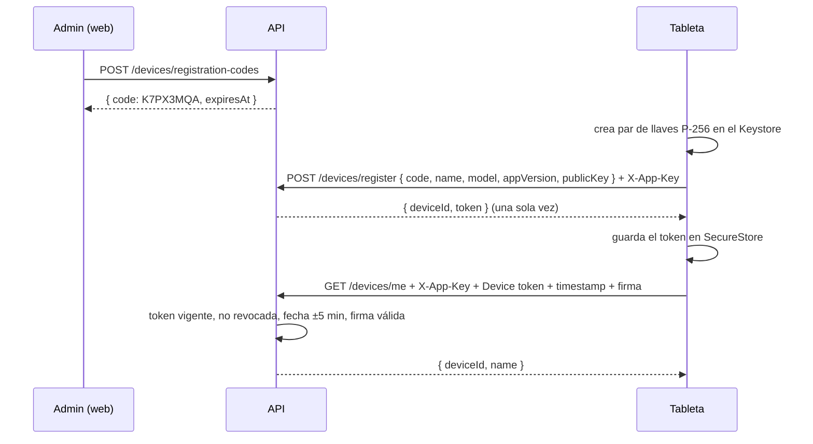

# Módulo `devices`

Registro y revocación de las **tabletas del Centro**, y autenticación de cada petición que hace una tableta. Es la contraparte de la app móvil (`~/Documents/tesis/frontend`, spec 001).

| Dato       | Valor                                                                                                                                                                                                           |
| ---------- | --------------------------------------------------------------------------------------------------------------------------------------------------------------------------------------------------------------- |
| Specs      | [103 — Gestión de tabletas](../../../caa-spec-driven-development-SDD-/specs/103-tabletas/spec.md) (FR-001 a FR-006), contrato de [001 — Registro de la tableta](../../../caa-spec-driven-development-SDD-/specs/001-registro-tableta/spec.md) |
| Depende de | `auth` (`TokenService` para hashes y tokens opacos, `AuthAuditLog`, decoradores)                                                                                                                                |
| Tablas     | `Device`, `DeviceRegistrationCode`                                                                                                                                                                              |
| Pruebas    | [`test/devices.e2e-spec.ts`](../../test/devices.e2e-spec.ts)                                                                                                                                                    |

## Por qué así: CORS no protege una app móvil

CORS lo aplica el **navegador** y solo sirve para la web (`CORS_ORIGINS`). Una app nativa no envía `Origin`, así que no hay forma de "aceptar solo la app" con CORS. Este módulo le pone a la tableta tres capas, sin Firebase:

| Capa                 | Header                                     | Qué prueba                                                                                                                                                  |
| -------------------- | ------------------------------------------ | ----------------------------------------------------------------------------------------------------------------------------------------------------------- |
| Clave de la app      | `X-App-Key`                                | Que el cliente es nuestra app. Va dentro del APK: **solo filtra** clientes ajenos                                                                           |
| Token de dispositivo | `Authorization: Device <token>`            | Que el admin registró esta tableta con un código. Opaco, revocable, la base guarda solo su SHA-256                                                          |
| Firma                | `X-Device-Timestamp`, `X-Device-Signature` | Que la petición sale de **la misma tableta**: ECDSA P-256 con una llave del Android Keystore que nunca sale del hardware. Un token robado no sirve sin ella |

## Reglas de negocio

| Regla                                                                                      | Origen                         | Dónde se cumple                                                      |
| ------------------------------------------------------------------------------------------ | ------------------------------ | -------------------------------------------------------------------- |
| La tableta es del Centro: baja todos los perfiles; la terapeuta elige su nombre por sesión | 103 FR-004, acuerdo 2026-10-21 | (sin dueño en `Device`; se guarda qué admin generó el código)        |
| Código de 8 caracteres sin 0, O, 1, I; vigencia de la configuración (15 min); un solo uso; exige el PIN del Centro actual | 001 FR-001, 103 criterios      | `generateRegistrationCode`, `RegistrationCode.issue/isUsable`        |
| Código inexistente, vencido o usado → mismo error "Código no válido o vencido"             | 001 criterios                  | `RegisterDeviceUseCase` → `InvalidRegistrationCode`                  |
| Dos tabletas con el mismo código a la vez: solo una gana                                   | 103                            | `registerDevice` con `updateMany where usedAt = null` en transacción |
| La base guarda solo hashes del código y del token                                          | 103 FR-001                     | `TokenService.hashOpaqueToken`                                       |
| `POST /devices/register`: 10 intentos por IP cada 15 minutos                               | 103 FR-002                     | `@Throttle` en el controller                                         |
| Firma de `MÉTODO\nruta\ntimestamp`, con máximo 5 minutos de diferencia                     | 103 FR-005                     | `AuthenticateDeviceUseCase` + `EcdsaSignatureVerifier`               |
| Revocar corta el acceso en la siguiente petición; la tableta y sus sesiones se conservan   | 103 criterios, FR-003          | `Device.revoke()`; nunca se borra                                    |
| Tableta revocada vuelve con un código nuevo, como tableta nueva                            | 103 criterios                  | registro normal                                                      |
| Más de 7 días sin sincronizar se marca `stale`                                             | 103 criterios                  | `Device.isStale()`                                                   |
| La última conexión se guarda como mucho una vez por minuto                                 | rendimiento                    | `Device.touch()`                                                     |

## Estructura

```
devices/
├── devices.module.ts
├── domain/
│   ├── entities/device.entity.ts              Device: revoke, isStale, touch
│   ├── entities/registration-code.entity.ts   RegistrationCode + generateRegistrationCode
│   ├── exceptions/devices.exceptions.ts       InvalidCode, InvalidPublicKey, DeviceUnauthorized, InvalidAppKey, DeviceNotFound
│   └── ports/devices.repository.ts            DevicesRepository + SignatureVerifier
├── application/
│   ├── create-registration-code     POST /devices/registration-codes
│   ├── register-device              POST /devices/register
│   ├── list-devices                 GET /devices
│   ├── revoke-device                POST /devices/:id/revoke
│   └── authenticate-device          regla de cada petición de la tableta (HTTP y, luego, WebSocket)
└── infrastructure/
    ├── http/device-auth.ts           AppKeyGuard, DeviceTokenGuard, @DeviceAuth(), @GetDevice()
    ├── http/devices.controller.ts    + response mapper (nunca expone tokenHash ni publicKey)
    ├── http/devices.dto.ts
    ├── prisma/                       repositorio + mapper
    └── security/ecdsa-signature.verifier.ts   node:crypto, P-256, firma DER
```

## Cómo funciona



Para proteger una ruta de la tableta (p. ej. `/sync/*` de la spec 106):

```ts
@DeviceAuth()
@Post('sync/batch')
batch(@GetDevice() device: Device) {}
```

`@DeviceAuth()` marca la ruta como `@Public()` para los guards de usuario (JWT y rol) y aplica `AppKeyGuard` + `DeviceTokenGuard`. Un JWT de usuario **no** sirve en estas rutas.

## Endpoints

| Método y ruta                      | Acceso                  | Respuesta                                                                                                               |
| ---------------------------------- | ----------------------- | ----------------------------------------------------------------------------------------------------------------------- |
| `POST /devices/registration-codes` | ADMIN                   | `{ centerPin }` (el PIN del Centro actual) → `201 { code, expiresAt }` / `403 WrongCenterPin` / `409 CenterPinNotSet` |
| `POST /devices/register`           | `X-App-Key`             | `201 { deviceId, token }` / `400 InvalidCode` / `400 InvalidPublicKey` / `429`                                          |
| `GET /devices?page=&limit=`        | ADMIN                   | `200` página de `{ id, name, model, appVersion, registeredAt, lastSeenAt, lastSyncAt, revokedAt, stale, authorizedBy }` |
| `POST /devices/:id/revoke`         | ADMIN                   | `204` / `404 DeviceNotFound`                                                                                            |
| `GET /devices/me`                  | tableta (`@DeviceAuth`) | `200 { deviceId, name }` / `401 DeviceUnauthorized` / `403 InvalidAppKey`                                               |
| `GET /devices/settings`            | tableta (`@DeviceAuth`) | `200 { centerName, centerPin: { salt, hash, iterations }, therapistTimeoutMinutes }` (módulo `settings`, spec 103 FR-008) |

## Auditoría

`DEVICE_CODE_CREATED` (admin), `DEVICE_REGISTERED` (actor `DEVICE`, con el admin que autorizó), `DEVICE_REVOKED` (admin). Entidad `Device`.

## Configuración

`APP_KEY` (obligatoria): la misma que `EXPO_PUBLIC_APP_KEY` de la app. Rotarla obliga a publicar una versión nueva de la app.

## Para agentes de IA (y quien modifique el módulo)

- Las rutas de la tableta llevan `@DeviceAuth()`; nunca `@Auth()` ni `@Public()` solos.
- El mensaje firmado es exactamente `MÉTODO\nruta-con-query\ntimestamp`: si cambia aquí, cambia en `frontend/src/services/device-auth.ts`.
- El token se entrega **una sola vez** al registrar; no agregues endpoints que lo devuelvan.
- No borres tabletas: revoca (`revokedAt`).
- Límite conocido (`ponytail:` en `authenticate-device.use-case.ts`): dentro de los 5 minutos una petición capturada podría repetirse; TLS lo evita y, si hace falta, se guardan los timestamps usados en Redis.
- Pendiente: el WebSocket de la spec 106 debe reutilizar `AuthenticateDeviceUseCase` en el handshake y cerrar el socket al revocar; `Play Integrity` cuando la app esté en Play Console.
