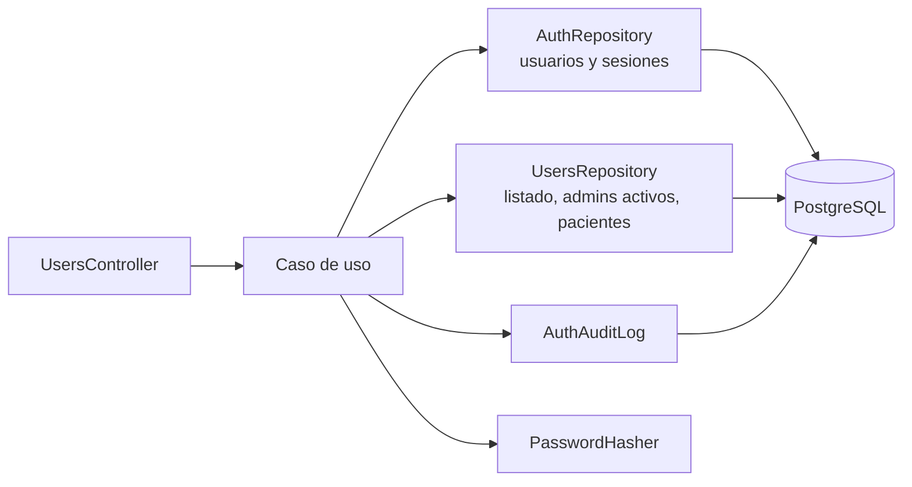

# Módulo `users`

Gestión de cuentas por el **administrador**: crear terapeutas con clave temporal, editar, desactivar o reactivar, asignar otra clave temporal y decidir qué pacientes atiende cada terapeuta. No hay autorregistro, y los administradores no se crean por la API.

| Dato       | Valor                                                                                                |
| ---------- | ---------------------------------------------------------------------------------------------------- |
| Spec       | [102 — Gestión de usuarios](../../../caa-spec-driven-development-SDD-/specs/102-usuarios/spec.md) (FR-001 a FR-004) |
| Depende de | `auth` (entidad `User`, `AuthRepository`, `PasswordHasher`, `AuthAuditLog`, decoradores)             |
| Tablas     | `User`, `RefreshToken` (revocar), `TherapistPatient`, `Patient` (solo `id`, `code`, `avatar`)        |
| Pruebas    | [`test/users.e2e-spec.ts`](../../test/users.e2e-spec.ts)                                             |

## Reglas de negocio

| Regla                                                                                                                                  | Origen                         | Dónde se cumple                                                                                |
| -------------------------------------------------------------------------------------------------------------------------------------- | ------------------------------ | ---------------------------------------------------------------------------------------------- |
| Todo el módulo es solo del administrador                                                                                               | 102 plan                       | `@Auth(Role.ADMIN)` en cada endpoint de `users.controller.ts`                                  |
| `POST /users` crea **solo** terapeutas, con clave temporal que debe cambiar en el primer login                                         | 102 FR-004, acuerdo 2026-10-21 | `create-account.use-case.ts` (`role` del cuerpo se ignora)                                   |
| Los usuarios no se borran: desactivar = `PATCH { active: false }`                                                                      | 102 FR-001                     | `update-user.use-case.ts`, `User.setActive()`                                                  |
| Desactivar, cambiar el correo o asignar clave temporal cierra sus sesiones                                                             | 102 criterios                  | `revokeAllRefreshTokens` / `savePasswordChange` de `AuthRepository`                            |
| No se puede desactivar al único administrador activo                                                                                   | 102 criterios                  | `update-user.use-case.ts` → `LastActiveAdmin`                                                  |
| Correo único (sin distinguir mayúsculas)                                                                                               | 102 criterios                  | `EmailTaken` en el caso de uso y, ante carreras, por la restricción única de la base (`P2002`) |
| El administrador ve código y avatar de los pacientes, nunca datos clínicos                                                             | 102 FR-002, constitución §5    | `UsersPrismaRepository` selecciona solo `id`, `code`, `avatar`                                 |
| Solo se asignan pacientes a terapeutas y que existan                                                                                   | 102 criterios                  | `replace-assigned-patients.use-case.ts`                                                        |
| Creación, cambios, clave temporal y asignación se auditan                                                                              | 102 FR-003, spec 109           | `AuthAuditLog`                                                                                 |
| PIN de tableta (spec 002): el admin solo lo **borra** (`DELETE /users/:id/pin`) y ve `hasPin`; nunca el PIN ni su hash                 | 002, 102 FR-005                | `clear-pin.use-case.ts`, `toUserResponse`                                                      |
| La tableta elige terapeuta (`GET /therapists`) y verifica su PIN (`POST /therapists/:id/pin-check`): 5 fallos = 60 s, 10 = PIN anulado | 002                            | `therapists.controller.ts` (`@DeviceAuth`), `User.registerPinFailure()`                        |

## Estructura

```
users/
├── users.module.ts                   importa AuthModule; UsersRepository → UsersPrismaRepository
├── domain/
│   ├── exceptions/users.exceptions.ts    UserNotFound, LastActiveAdmin, NotAssignable, UnknownPatients
│   └── ports/users.repository.ts         lo que users necesita además de AuthRepository
├── application/                      un caso de uso por acción
│   ├── list-users                    GET /users
│   ├── create-therapist              POST /users
│   ├── update-user                   PATCH /users/:id
│   ├── assign-temporary-password     POST /users/:id/temporary-password
│   ├── get-assigned-patients         GET /users/:id/patients
│   └── replace-assigned-patients     PUT /users/:id/patients
└── infrastructure/
    ├── http/users.controller.ts      response mapper (nunca expone passwordHash) + ParseUUIDPipe
    ├── http/users.dto.ts             validación de entrada (trim de nombre y correo)
    └── prisma/users.prisma.repository.ts
```

**Por qué no tiene entidad propia:** el usuario es uno solo en toda la API y vive en `auth/domain/entities/user.entity.ts`. Users agrega comportamiento (`rename`, `changeEmail`, `setActive`, `assignTemporaryPassword`) a esa misma entidad en lugar de duplicarla.

## Cómo funciona



- **Editar (`PATCH`)**: solo guarda y audita si algo cambió de verdad; la auditoría lista los campos cambiados (`summary.fields`).
- **Asignar pacientes (`PUT`)**: reemplaza la lista completa en una transacción (`deleteMany` de los que salen + `createMany skipDuplicates` de los que entran). Ids repetidos se ignoran. La auditoría guarda los **códigos** agregados y quitados, nunca nombres.

## Endpoints

Los de `/users` con `@Auth(Role.ADMIN)`; los de `/therapists`, con `@DeviceAuth()` (la tableta, spec 002). `:id` debe ser UUID (si no, `400`).

| Método y ruta                              | Cuerpo                               | Respuesta                                                                                     |
| ------------------------------------------ | ------------------------------------ | --------------------------------------------------------------------------------------------- |
| `GET /users?role=&active=&page=&limit=`    | —                                    | `200` página de `{ id, name, email, role, active, mustChangePassword, createdAt }` por nombre |
| `POST /users`                              | `{ name, email, temporaryPassword }` | `201` usuario `THERAPIST` con `mustChangePassword: true`                                      |
| `PATCH /users/:id`                         | `{ name?, email?, active? }`         | `200` usuario                                                                                 |
| `POST /users/:id/temporary-password`       | `{ temporaryPassword }`              | `204`                                                                                         |
| `DELETE /users/:id/pin`                    | —                                    | `204` (la terapeuta debe crear otro PIN)                                                      |
| `GET /therapists?page=&limit=` (tableta)   | —                                    | `200` página de `{ id, name, hasPin }`, solo terapeutas activas                               |
| `POST /therapists/:id/pin-check` (tableta) | `{ pin }`                            | `200 { therapistId, name }`                                                                   |
| `GET /users/:id/patients?page=&limit=`     | —                                    | `200` página de `{ id, code, avatar }` por código                                             |
| `PUT /users/:id/patients`                  | `{ patientIds: uuid[] }` (máx. 1000) | `200` lista nueva ordenada por código                                                         |

## Errores

| `error`                            | HTTP | Cuándo                                                                    |
| ---------------------------------- | ---- | ------------------------------------------------------------------------- |
| `EmailTaken`                       | 409  | correo ya registrado (al crear o al cambiarlo)                            |
| `LastActiveAdmin`                  | 409  | desactivar al único admin activo                                          |
| `UserNotFound`                     | 404  | `:id` no existe                                                           |
| `NotAssignable`                    | 400  | asignar pacientes a un admin                                              |
| `UnknownPatients`                  | 400  | algún `patientId` no existe                                               |
| `WeakPassword` / `ValidationError` | 400  | clave temporal débil o cuerpo inválido                                    |
| `WrongPin`                         | 400  | PIN incorrecto (400, no 401: la tableta trata el 401 como token revocado) |
| `PinLocked`                        | 429  | 5.º fallo seguido y los 60 s siguientes                                   |
| `PinRevoked`                       | 409  | 10.º fallo: el PIN se anuló                                               |
| `PinNotSet`                        | 409  | la terapeuta no tiene PIN                                                 |
| `TherapistNotFound`                | 404  | no existe, está desactivada o no es terapeuta                             |

## Auditoría

`USER_CREATE` (`summary: { role, source: 'admin' }`), `USER_UPDATE` (`{ fields, active }`), `TEMP_PASSWORD_SET`, `PIN_CLEARED`, `PATIENTS_ASSIGNED` (`{ added, removed }` con códigos `P-0001`). Actor: el administrador que hizo la acción. Las verificaciones de PIN las registra la tableta (actor `DEVICE`): `THERAPIST_PIN_OK`, `THERAPIST_PIN_FAILED`, `THERAPIST_PIN_REVOKED`.

## Para agentes de IA (y quien modifique el módulo)

- Cada endpoint nuevo lleva `@Auth(Role.ADMIN)`; la terapeuta nunca entra a este módulo.
- No devuelvas la fila de Prisma ni la entidad: pasa siempre por `toUserResponse` (no debe salir `passwordHash`).
- No expongas datos clínicos de pacientes aquí (solo `id`, `code`, `avatar`).
- No agregues `DELETE /users/:id`: la spec prohíbe borrar usuarios.
- Límite conocido: la regla del último admin cuenta y luego guarda sin candado (`ponytail:` en `update-user.use-case.ts`); con 1–2 administradores no se justifica un lock.
- Si cambias una regla, **primero** la spec 102 y luego el código y `test/users.e2e-spec.ts`.
